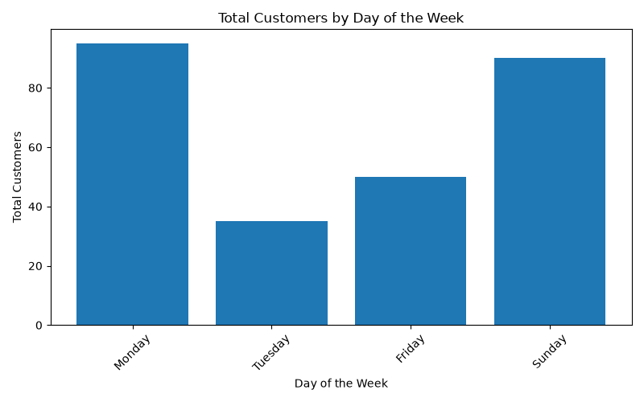
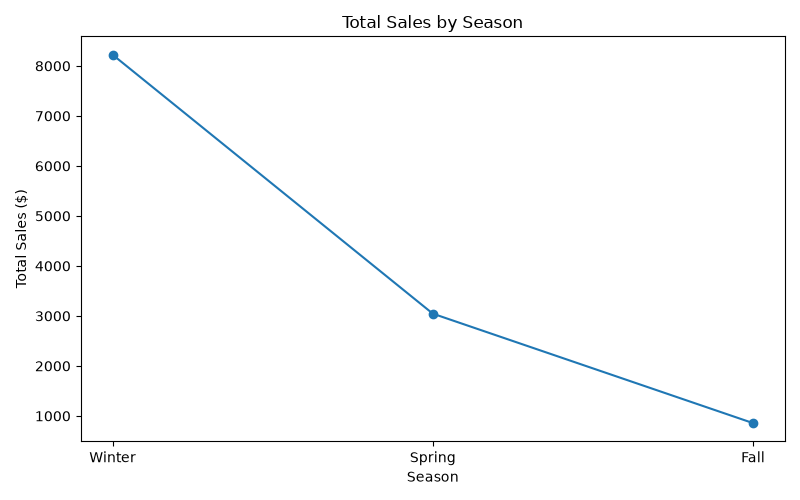

# Busy Shift Predictor

## Business Problem
Resteraunt servers often have difficulty predicting how busy their upcoming shift will be. Customer traffic can change depending on the season and day of the week, which can make it difficult to prepare for busy shifts and properly estimate how much money they might earn in tips. 

The Busy Shift Predictor keeps track of previous shifts, customer counts, and total sales. It will eventually use this information to predict how busy future shifts may be. 

## Business Question
How busy is my upcoming shift likely to be, and how much should I expect to earn in tips?

## How to Run
1. Open the project folder in VS Code
2. Run `main.py`
3. Choose an option from the menu

## Menu Options
1. Record a Shift
2. View Shift History
3. View Transactions
4. Shift Report
5. Predict Shift Busyness
6. Estimate Tips
7. Run Customer Simulation
8. View Charts
9. Save and Exit

## Files
- `main.py` - Runs the program and displays the menu.
- `shifts.py` - Loads and saves CSV data, displays shifts, records transactions, and validates input.
- `reports.py` - Creates the shift report, calculates group totals, and creates charts.
- `shifts.csv` - Stores the shift history dictionary.
- `transactions.csv` - Stores individual shift transactions.
- `customers_by_day.png` - Chart showing customers by day of the week
- `sales_by_season.png` - Chart showinf total sales by season
- `README.md` - Explains the project and how to use it.

## Charts

This chart shows which days of the week have the most customers, helping me know which of my shifts are more likley to be busier than others.

This chart compares sales across season to help identify ehich seasons are the busyest ir most profitable.

## Author
Matilda Pinjuv